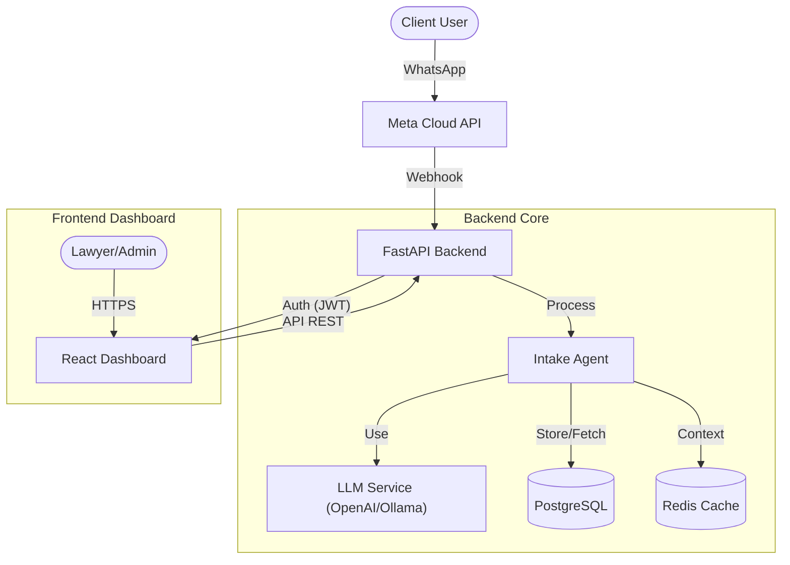

# Smart Lawyer Assistant Platform


A production-grade, enterprise-ready legal intake and workflow automation system designed to streamline client onboarding via WhatsApp and provide a powerful dashboard for legal professionals.

## 🏗 Architecture Overview

The system follows a modern microservices-inspired architecture, separating the intake channel (WhatsApp/AI) from the management interface (Dashboard).



## 🚀 Key Features

*   **🤖 AI-Powered Intake Agent**:
    *   Automated conversation handling via WhatsApp.
    *   State machine logic for structured data gathering (Client Info, Case Type, Incident Details).
    *   Hybrid AI Support: OpenAI (GPT-4) for complex tasks, Ollama (Llama 3) for local/cost-effective processing.
*   **📱 Omnichannel Integration**: 
    *   Seamless integration with WhatsApp Cloud API.
    *   Supports Text, Images (OCR), and Audio (Whisper Transcription - *Coming Soon*).
*   **💻 Premium Dashboard**:
    *   Modern, glassmorphism-inspired UI built with React, Vite, and Tailwind CSS.
    *   Real-time case listing with status tracking and urgency indicators.
    *   Detailed case views with full conversation history and AI-generated summaries.
*   **🔐 Enterprise Security**:
    *   Role-Based Access Control (RBAC).
    *   JWT Authentication with refresh tokens.
    *   Secure password hashing (Bcrypt).

## 🛠 Tech Stack

| Component | Technology | Description |
| :--- | :--- | :--- |
| **Backend** | Python 3.11+, FastAPI | High-performance Async API framework. |
| **Database** | PostgreSQL, SQLAlchemy | Robust relational database with Async ORM. |
| **Frontend** | React, TypeScript, Vite | Modern, fast frontend tooling. |
| **Styling** | Tailwind CSS | Utility-first CSS framework for distinct UI. |
| **AI/LLM** | OpenAI API, Ollama | Flexible AI model integration. |
| **Infrastructure** | Docker, Docker Compose | Containerized deployment. |

## 🏁 Getting Started

### Prerequisites

*   Docker & Docker Compose
*   Node.js 18+ (for local frontend dev)
*   **Ngrok** (Authenticated account required for WhatsApp Webhook)

### 1. Environment Configuration

Clone the repo and configure your environment variables:

```bash
cd backend
cp .env.example .env
```

Edit `.env` and provide your keys:

```ini
# Core
DATABASE_URL=postgresql+asyncpg://postgres:postgres@db:5432/smart_lawyer
SECRET_KEY=your_super_secret_key

# External APIs
OPENAI_API_KEY=sk-...
WHATSAPP_ACCESS_TOKEN=...
WHATSAPP_PHONE_NUMBER_ID=...
WHATSAPP_VERIFY_TOKEN=my_secure_token

# Local AI (Optional)
OLLAMA_BASE_URL=http://host.docker.internal:11434/v1
OLLAMA_MODEL=llama3:8b
```

### 2. Launch with Docker

Start the backend services (Database, API, Redis):

```bash
docker-compose up --build
```

The API will be available at `http://localhost:8000`.

### 3. Start Frontend

```bash
cd frontend
npm install
npm run dev
```

The Dashboard will be available at `http://localhost:5174` (or 5173).

### 4. Connect WhatsApp (Ngrok)

To receive WhatsApp messages, you must expose your local backend to the internet.

1.  **Start Ngrok**:
    ```bash
    ngrok http 8000
    ```
2.  **Copy URL**: Get the HTTPS URL (e.g., `https://xyz.ngrok-free.app`).
3.  **Meta Dashboard**:
    *   Go to your App Dashboard > WhatsApp > Configuration.
    *   Edit **Webhook**.
    *   **Callback URL**: `https://<YOUR-NGROK-URL>/api/v1/whatsapp/webhook`
    *   **Verify Token**: `my_secure_token` (from your .env)
    *   Verify and Save.

## 🔐 Credentials

*   **Dashboard Login**: `user@example.com` (Registration pending implementation, currently mocked for demo access).
*   **Database**: `postgres` / `postgres`.

## 🤝 Contribution

1.  Fork the repository.
2.  Create your feature branch (`git checkout -b feature/AmazingFeature`).
3.  Commit your changes (`git commit -m 'Add some AmazingFeature'`).
4.  Push to the branch (`git push origin feature/AmazingFeature`).
5.  Open a Pull Request.

---
© 2024 Smart Lawyer Platform. All Rights Reserved.
